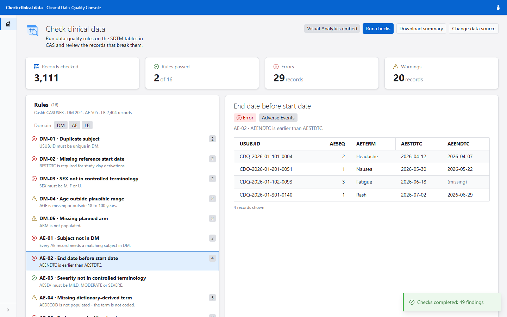
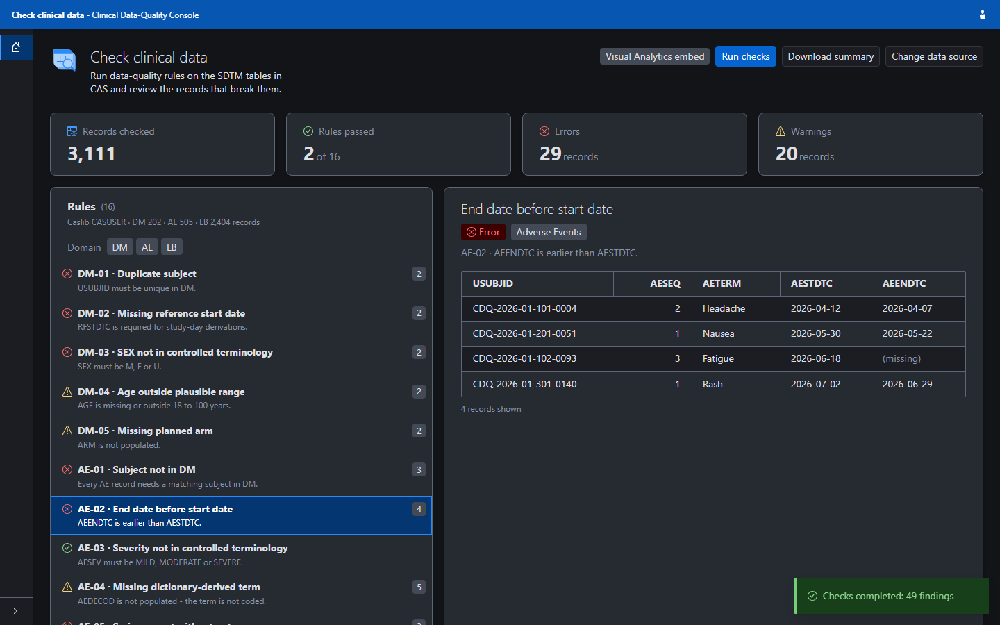
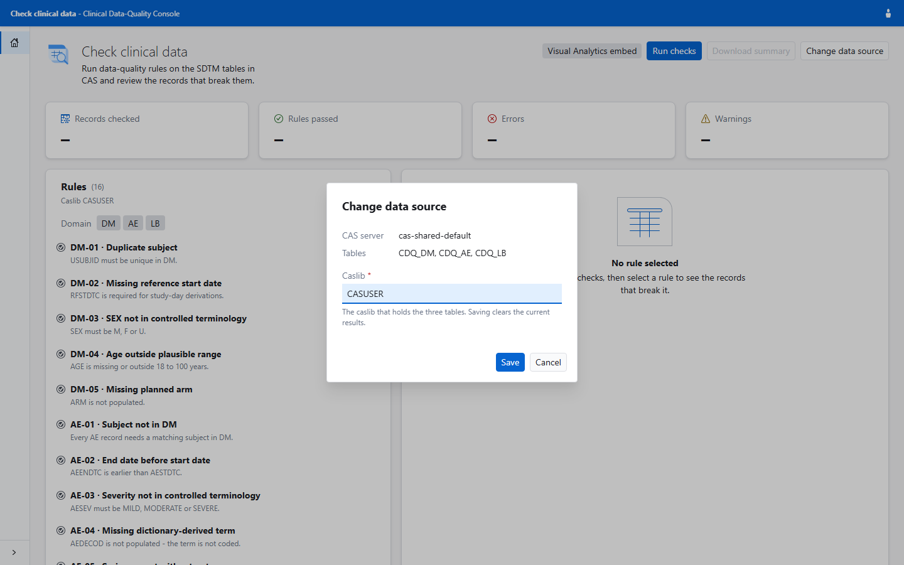
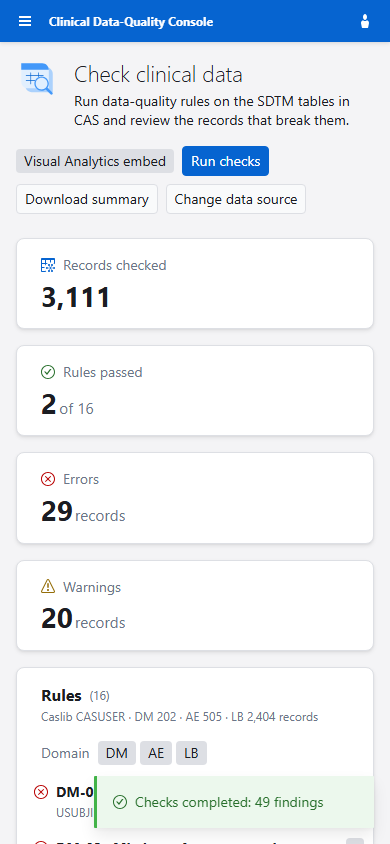

# Clinical Data-Quality Console

A small demo app on the SAS Viya REST APIs. It runs 16 data-quality rules on
three SDTM-style tables (DM, AE, LB) in CAS and shows the records that break
each rule. All data is synthetic; there is no real patient data in this
repository.

The app is one React codebase that ships to three places:

| Target | Command | Sign-in |
|---|---|---|
| Web app | `npm run build` | SAS Logon session cookie |
| Visual Analytics embed (SAS Job Execution form, one HTML file) | `npm run build:jobdef` | none, inherits the SAS session |
| Desktop app (Electron) | `npm run electron:build` | authorization code + PKCE in the main process |

Feature code never asks which target it runs in. `vite.config.ts` reads
`BUILD_MODE` and swaps the `src/auth` module at build time.

## Screenshots

The screenshots were taken from the embed build with canned responses instead
of a live SAS Viya, so the numbers are illustrative.

Results after a run: KPI tiles, the rule list and the records of the selected rule.

The same page in the dark theme (account menu, top right).

The caslib is set in the "Change data source" dialog.

On a phone-sized window the panels stack.

## What it does

1. **Run checks** opens a CAS session and counts the records in the three tables.
2. Each rule is one FedSQL query that returns the offending records. The app
   counts them rule by rule and updates the list as it goes.
3. Selecting a rule with findings loads its records (up to 200) into a sortable grid.
4. **Download summary** saves the result per rule as a CSV file.

The rules live in `src/rules.ts`. Examples: duplicate subjects in DM, an
adverse event that ends before it starts, a lab result without a unit.

## SAS Viya APIs used

SAS Viya authorises every call as the signed-in user. The app holds no
permissions of its own.

| What | Call | Reference |
|---|---|---|
| Open a CAS session | `POST /casManagement/servers/{server}/sessions` | [CAS Management: Create a session](https://developer.sas.com/rest-apis/casManagement/createSession) |
| Close the CAS session at sign-out | `DELETE /casManagement/servers/{server}/sessions/{id}` | [CAS Management: End a session](https://developer.sas.com/rest-apis/casManagement/deleteSession) |
| Run the `fedSql.execDirect` action | `POST /casProxy/servers/{server}/cas/sessions/{id}/actions/fedSql.execDirect` | [CAS REST API: Run action](https://developer.sas.com/rest-apis/cas/runAction), [CAS actions](https://developer.sas.com/programming/cas_actions) |
| Sign in from the desktop app | `GET /SASLogon/oauth/authorize`, `POST /SASLogon/oauth/token` | [SAS Logon API](https://developer.sas.com/rest-apis/SASLogon), [authorization code grant](https://developer.sas.com/rest-apis/SASLogon/grantAuthorizationCode) |

Notes:

- The app reaches the CAS REST API through the `casProxy` route, which accepts
  the same session cookie or bearer token as every other SAS Viya service.
  `casProxy` has no reference page of its own on developer.sas.com; the request
  and response are those of the CAS REST API "Run action" operation.
- The web app signs in with
  [`@sassoftware/sas-auth-browser`](https://www.npmjs.com/package/@sassoftware/sas-auth-browser),
  which uses the SAS Logon session cookie.
- All calls go through one client, `src/api/client.ts`, which also handles the
  CSRF token that SAS Viya returns on the first modifying request.
